# Лабораторная работа №3. Облачные сети. Amazon VPC

| | |
|---|---|
| **ФИО** | `Cherpici Nichita` |
| **Группа** | `IA2404` |
| **Специальность** | `<специальность>` |
| **Номер k** | `<k>` (X = k % 30 = **5**) |
| **Уровень** | продвинутый |
| **Регион AWS** | eu-central-1 (Frankfurt) |
| **Owner (тег)** | Ankord |

---

## Задание 1. План адресов

VPC: `10.5.0.0/16`.

| Подсеть | Зона доступности | Диапазон | Первый и последний адрес для экземпляров | Сколько адресов |
|---|---|---|---|---|
| public-a | eu-central-1a | 10.5.0.0/24 | 10.5.0.4 – 10.5.0.254 | 251 |
| public-b | eu-central-1b | 10.5.1.0/24 | 10.5.1.4 – 10.5.1.254 | 251 |
| private-a | eu-central-1a | 10.5.10.0/24 | 10.5.10.4 – 10.5.10.254 | 251 |
| private-b | eu-central-1b | 10.5.11.0/24 | 10.5.11.4 – 10.5.11.254 | 251 |

**Почему доступных адресов не 256?** В каждой подсети AWS резервирует 5 адресов. Для `10.5.0.0/24` это:

- `10.5.0.0` – адрес сети;
- `10.5.0.1` – виртуальный маршрутизатор VPC;
- `10.5.0.2` – DNS-сервер VPC (базовый адрес сети + 2);
- `10.5.0.3` – зарезервирован AWS для будущего использования;
- `10.5.0.255` – широковещательный адрес (в VPC broadcast не поддерживается, но адрес всё равно занят).

Итого 256 − 5 = 251 адрес. В VPC `/16` помещается 2^(24−16) = 256 подсетей `/24`; четыре уже заняты, значит, ещё **252**.

---

## Задание 2. VPC и подсети

Создана VPC `timecapsule-dev-vpc` (`vpc-0dbfeac1d0dd018b1`) с диапазоном `10.5.0.0/16`, DNS resolution включён. Созданы четыре подсети по таблице из задания 1.

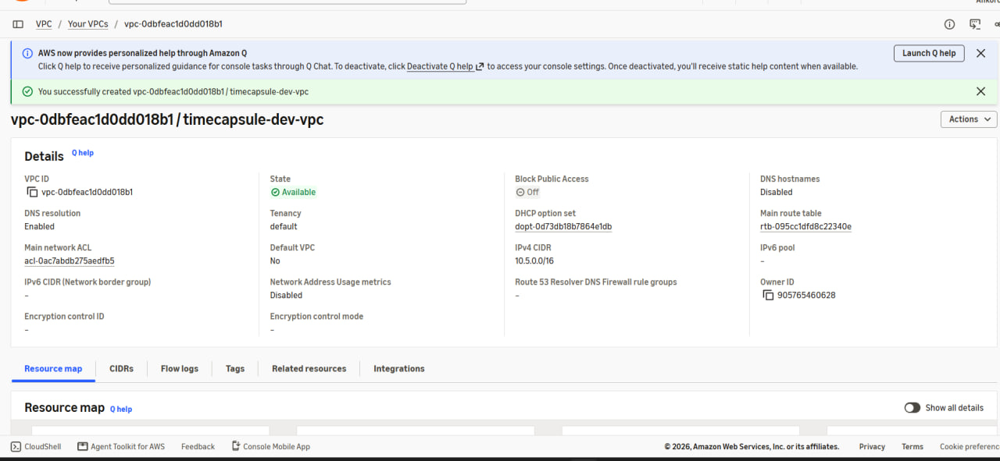

*Страница VPC `timecapsule-dev-vpc`: IPv4 CIDR 10.5.0.0/16, состояние Available, DNS resolution включён.*

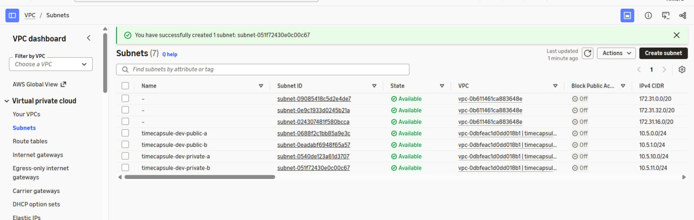

*Список подсетей: public-a (10.5.0.0/24), public-b (10.5.1.0/24), private-a (10.5.10.0/24), private-b (10.5.11.0/24), все Available.*

**Является ли public-a сейчас публичной?** Нет. Подсеть публична не по названию, а из-за маршрута `0.0.0.0/0` в Internet Gateway. Сейчас у подсети только локальный маршрут VPC, а Internet Gateway ещё не создан.

---

## Задание 3. Internet Gateway и таблицы маршрутов

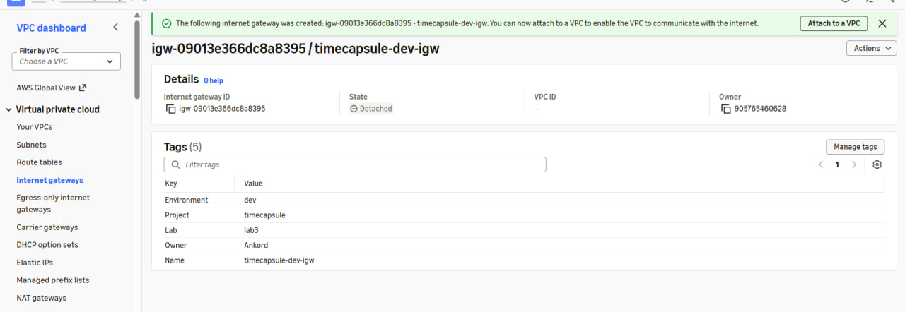

*Internet Gateway `timecapsule-dev-igw` сразу после создания: состояние Detached, пять обязательных тегов (Name, Project, Environment, Owner, Lab).*

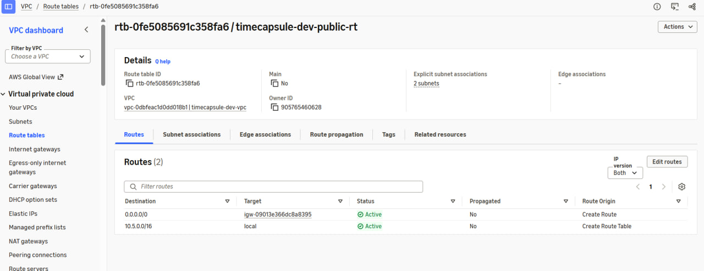

*`timecapsule-dev-public-rt`: маршрут `0.0.0.0/0` → `igw-09013e366dc8a8395` и локальный `10.5.0.0/16`; связана с двумя подсетями (public-a, public-b).*

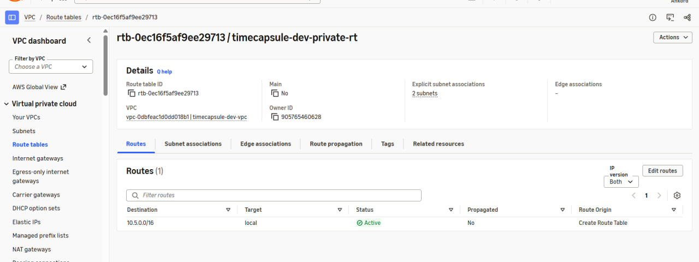

*`timecapsule-dev-private-rt`: только локальный маршрут `10.5.0.0/16`; связана с двумя подсетями (private-a, private-b).*

**Какой маршрут есть в обеих таблицах, хотя вы его не добавляли? Что он даёт? Куда уйдёт пакет из private-a, адресованный 8.8.8.8?**
Это маршрут `10.5.0.0/16 → local`. Он создаётся вместе с таблицей и позволяет любым ресурсам VPC связываться друг с другом, независимо от подсети и зоны доступности. Пакет из private-a на `8.8.8.8` не подходит ни под один маршрут (в `private-rt` нет `0.0.0.0/0`), поэтому будет отброшен и в интернет не уйдёт.

---

## Задание 4. Security Group

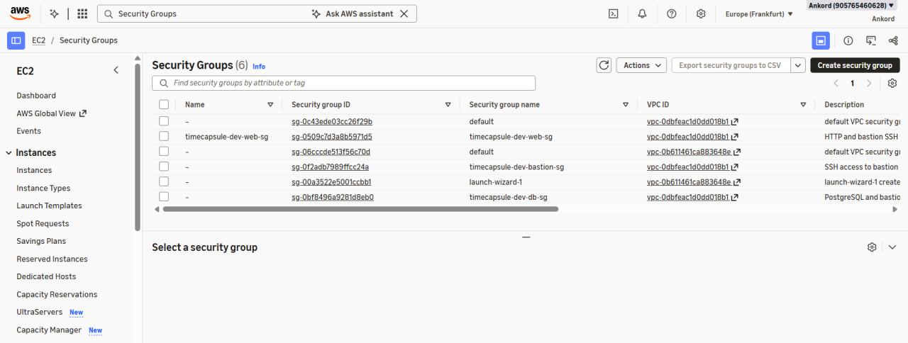

*Группы `timecapsule-dev-web-sg`, `timecapsule-dev-bastion-sg` и `timecapsule-dev-db-sg` созданы в VPC `vpc-0dbfeac1d0dd018b1`.*

> **Скриншот входящих правил:** `<добавить скриншот вкладки Inbound rules для трёх групп>`

Входящие правила:

| Группа | Порт | Источник |
|---|---|---|
| bastion-sg | SSH 22 | My IP |
| web-sg | HTTP 80 | 0.0.0.0/0 |
| web-sg | SSH 22 | bastion-sg |
| db-sg | PostgreSQL 5432 | web-sg |
| db-sg | SSH 22 | bastion-sg |

**Почему в db-sg источником указана группа web-sg, а не адрес веб-сервера или диапазон 10.5.0.0/16?**
Правило со ссылкой на группу действует для любого экземпляра, которому назначена `web-sg`, и не зависит от его IP: если сервер пересоздадут с другим адресом, правило продолжит работать. Диапазон `10.5.0.0/16` открыл бы порт всем серверам VPC, включая bastion и любой будущий сервер, а это нарушает принцип минимально необходимого доступа.

---

## Задание 5. Экземпляры

| Роль | Подсеть | Приватный IP | Публичный IP | Security Group |
|---|---|---|---|---|
| bastion | public-b | 10.5.1.77 | да | bastion-sg |
| web-server | public-a | 10.5.0.194 | да | web-sg |
| db-server | private-a | 10.5.10.160 | нет | db-sg |

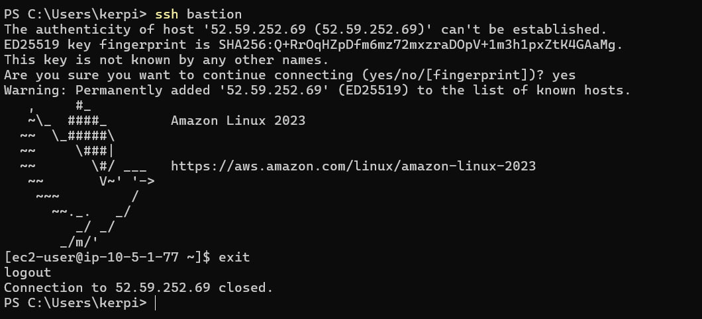

*`ssh bastion`: вход на bastion (`ip-10-5-1-77`) по публичному адресу.*

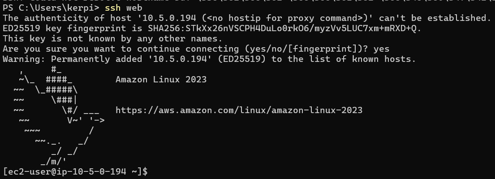

*`ssh web`: вход на web-server (`ip-10-5-0-194`) через bastion по `ProxyJump`, по приватному адресу `10.5.0.194`.*

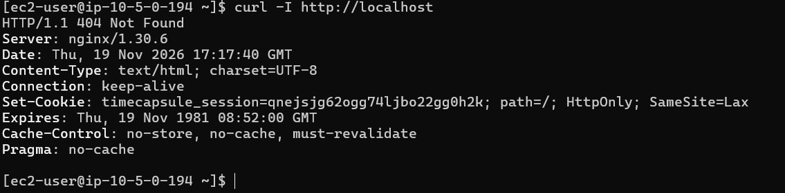

*Проверка `curl -I http://localhost` на web-server: отвечает nginx/1.30.6 (приложение TimeCapsule).*

> **Скриншоты, которых не хватает:** `<страница web-server в браузере по публичному IP>` и `<зависшая установка postgresql16-server на db-server до создания NAT Gateway>`.

**Почему db-server не может скачать пакеты, хотя web-server это делает? Что нужно добавить в сеть, чтобы это стало возможно, и при этом db-server остался недоступным из интернета?**
У web-server есть публичный адрес и маршрут `0.0.0.0/0` в Internet Gateway, а у db-server нет ни публичного адреса, ни маршрута в интернет. Нужен NAT Gateway в публичной подсети и маршрут `0.0.0.0/0 → NAT` в `private-rt`. NAT пропускает только исходящие соединения, поэтому подключиться к db-server из интернета по-прежнему нельзя.

---

## Задание 6. Временный NAT Gateway

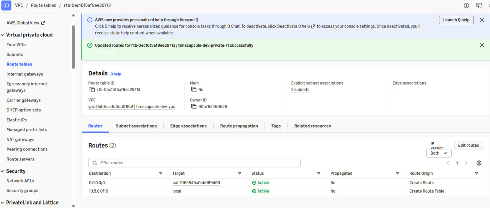

*В `private-rt` добавлен маршрут `0.0.0.0/0` → `nat-1065945a0eb089d63` (Active).*

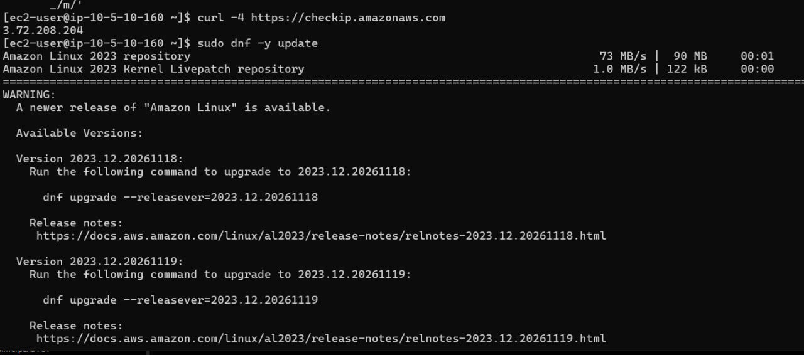

*С db-server (`ip-10-5-10-160`) выполнены `curl -4 https://checkip.amazonaws.com` (ответ `3.72.208.204`) и `sudo dnf -y update`: пакеты скачиваются через NAT.*

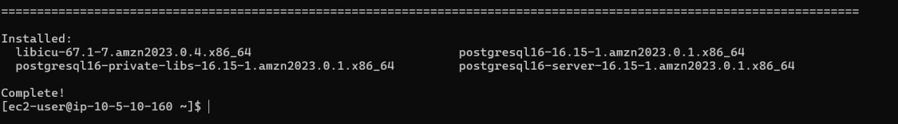

*Установка `postgresql16-server` 16.15 завершена (`Complete!`).*

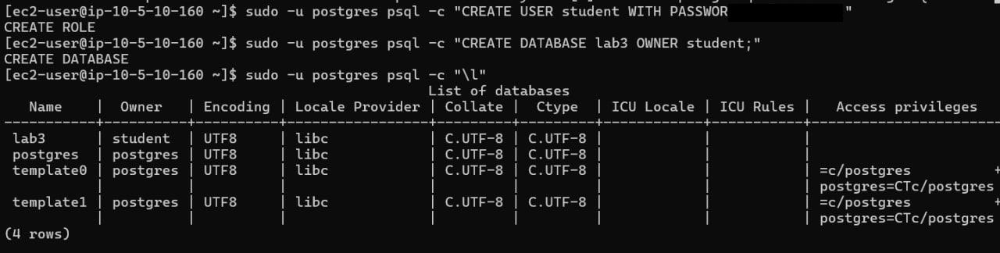

*Создание пользователя `student` и базы `lab3`. Пароль закрыт. Список баз `\l` показывает `lab3` с владельцем `student`.*

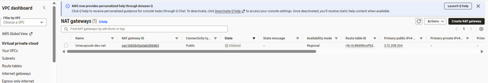

*Список NAT gateways: шлюз `timecapsule-dev-nat` в состоянии **Deleted**, его Elastic IP — `3.72.208.204`.*

> **Скриншот не приложен:** маршрут `0.0.0.0/0` в `private-rt` в состоянии Blackhole (сделан до удаления маршрута). `<добавить, если он есть>`

**Какой адрес вернула первая команда? Сравните его с Elastic IP NAT Gateway. Почему это не адрес db-server?**
Команда вернула `3.72.208.204`. Это тот же адрес, что указан как Primary public IPv4 у NAT Gateway (см. скриншот со списком NAT). У db-server нет публичного адреса: NAT Gateway подменяет исходящий адрес всех серверов приватной подсети на свой Elastic IP, поэтому внешний сайт видит адрес шлюза.

**Что делает каждый из трёх механизмов защиты базы? Что будет, если ошибиться только в одном?**

- *Отсутствие публичного адреса и маршрута в Internet Gateway* — сервер недостижим из интернета на уровне сети.
- *Security Group `db-sg`* — разрешает порт 5432 только от `web-sg`, остальным пакетам фильтр не даёт дойти до сервера.
- *`pg_hba.conf`* — PostgreSQL принимает вход только с адресов `10.5.0.0/24` и только по паролю.

Защита построена слоями: если ошибиться в одном слое, остальные всё равно блокируют доступ. Для успешной атаки нужно ошибиться во всех трёх.

**Почему PostgreSQL продолжает работать после удаления NAT Gateway? Что придётся сделать, когда на db-server понадобится установить обновления безопасности?**
NAT нужен только для исходящих соединений к репозиториям. Локально и по приватной сети PostgreSQL работает без интернета, а клиенты подключаются через локальный маршрут VPC. Для установки обновлений придётся снова временно создать NAT Gateway, добавить маршрут в `private-rt`, выполнить `dnf update`, затем удалить шлюз, маршрут и освободить Elastic IP.

---

## Задание 7. Проверки

### Доступ к базе

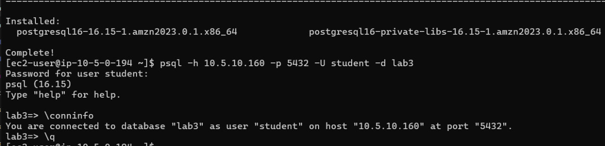

*С web-server (`ip-10-5-0-194`) установлен клиент `postgresql16`, затем выполнено `psql -h 10.5.10.160 -p 5432 -U student -d lab3`. После ввода пароля `\conninfo` подтверждает подключение к базе `lab3` как `student`.*

### Security Group в действии

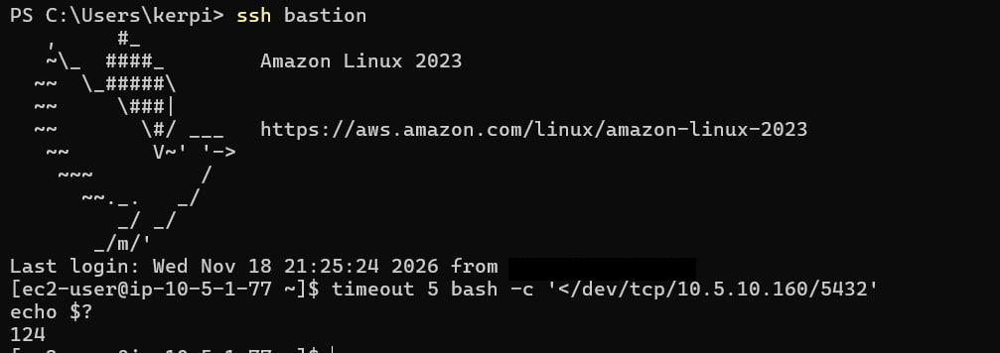

*С bastion (`ip-10-5-1-77`): `timeout 5 bash -c '</dev/tcp/10.5.10.160/5432'` завершилась по таймауту, `echo $?` → **124**, то есть порт закрыт.*

С web-server подключение к порту 5432 проходит (см. успешный `psql` выше).

**Почему с web-server порт открыт, а с bastion нет, хотя оба сервера в одной VPC и маршрут между ними есть?**
Маршрутизация только доставляет пакеты, а решение о пропуске принимает Security Group. В `db-sg` порт 5432 разрешён только для источника `web-sg`; у bastion группа `bastion-sg`, поэтому пакет отбрасывается, и соединение уходит в таймаут.

### Изоляция базы

**Почему запрос `curl -m 5 https://github.com` с db-server не проходит? Можно ли из интернета подключиться к порту 5432 db-server?**
После удаления NAT Gateway в `private-rt` остался только локальный маршрут, поэтому у пакета к GitHub нет пути наружу. Из интернета к 5432 подключиться нельзя по цепочке:

1. *Маршрут:* у private-a нет маршрута в Internet Gateway.
2. *Адрес:* у db-server нет публичного IP, по которому его можно было бы адресовать.
3. *Фильтры:* даже изнутри VPC `db-sg` пропускает 5432 только от `web-sg`.

### Network ACL

> **Скриншоты не приложены:** правило 90 Deny для моего IP в Network ACL, результат `ssh bastion` и открытия сайта до/после, проверка с телефона через мобильный интернет. `<добавить>`

**Почему заблокировано и SSH, и сайт, хотя Security Group не менялись?**
Network ACL работает на границе подсети и проверяется раньше Security Group. Правило `Deny All traffic` для `<мой IP>/32` блокирует любой трафик с моего адреса, поэтому недоступны и SSH на bastion, и HTTP на web-server.

**Почему с телефона сайт открывается?**
Правило запрещает только один адрес — мой. У телефона в мобильной сети другой внешний IP, и он под запрет не попадает.

**Почему правило должно иметь номер меньше 100?**
Network ACL обрабатывает правила по возрастанию номеров, и срабатывает первое подошедшее. В ACL по умолчанию правило `100` разрешает весь трафик, поэтому `Deny` с номером 90 сработает раньше. Если дать ему номер больше 100, до него дело не дойдёт.

### Имена и теги

> **Скриншот не приложен:** Tag Editor с фильтром `Project = timecapsule` в регионе eu-central-1. `<добавить>`

Замечание по тегам: в списке Security Group у `timecapsule-dev-bastion-sg` и `timecapsule-dev-db-sg` колонка Name пустая («–»), заполнена только у `timecapsule-dev-web-sg` (см. скриншот в задании 4). Для этих двух групп нужно добавить тег `Name` с тем же значением, что и в имени группы.

**Как по тегам найти все ресурсы, которые нужно удалить после окончания проекта? Зачем нужен тег Owner, если аккаунт личный?**
Нужно найти в Tag Editor все ресурсы по `Project = timecapsule` (при необходимости добавив `Lab = lab3`) и удалить найденное. Тег `Owner` показывает, кто отвечает за ресурс. В личном аккаунте он закладывает привычку к рабочему соглашению: в общем аккаунте команды по нему понимают, кого спрашивать и кто платит.

---

## Итог

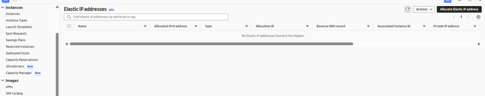

*Elastic IP addresses: в регионе нет ни одного адреса, значит, адрес NAT Gateway освобождён.*

NAT gateways: единственный шлюз `timecapsule-dev-nat` находится в состоянии Deleted (см. скриншот в задании 6). Экземпляры bastion, web-server и db-server после занятия нужно остановить.

### Дополнительно (начало Части 2)

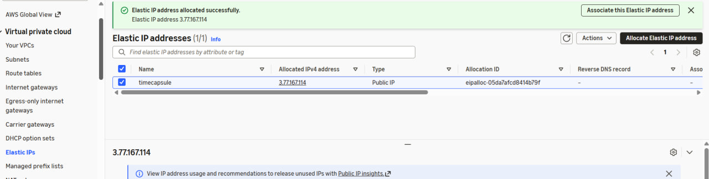

*Выделен Elastic IP `3.77.167.114` для app-server (Часть 2, задание 9). В списке он пока без привязки и имеет имя `timecapsule`, а по соглашению должен называться `timecapsule-dev-app-eip`. Для базового уровня этот адрес нужно освободить, иначе он оплачивается постоянно.*

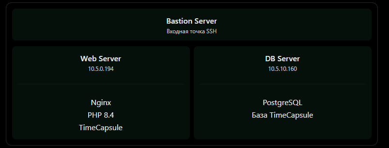

*Черновик схемы (набросок сервисов): bastion — точка входа SSH, web-server `10.5.0.194` (Nginx, PHP 8.4, TimeCapsule), db-server `10.5.10.160` (PostgreSQL, база TimeCapsule).*
