# Лабораторная работа №4. Облачные хранилища. Amazon S3

|  |  |
|---|---|
| **Группа** | IA2404 |
| **Уровень** | Продвинутый (задания 1–14) |


Регион: `eu-central-1` (Frankfurt). Бакет: `timecapsule-dev-uploads-ankord`. Номера рисунков совпадают с номерами файлов в `img/`.

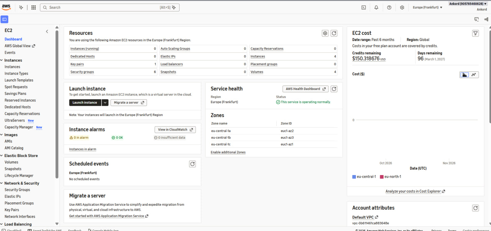

*Рисунок 1 — Консоль AWS, регион Europe (Frankfurt), ресурсы ЛР3 остановлены.*

---

# Часть 1. Базовый уровень

## Задание 1. Бакет и объекты в консоли

Создан бакет `timecapsule-dev-uploads-ankord`: General purpose, ACLs disabled, Block all public access, версионирование выключено, шифрование SSE-S3.

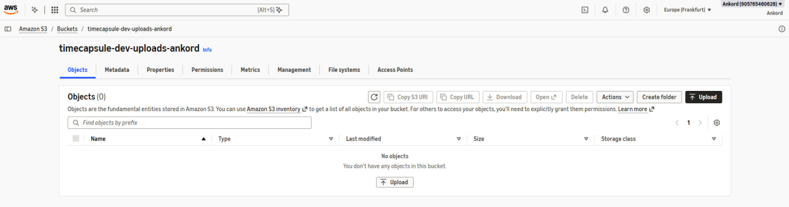

*Рисунок 2 — Созданный пустой бакет.*

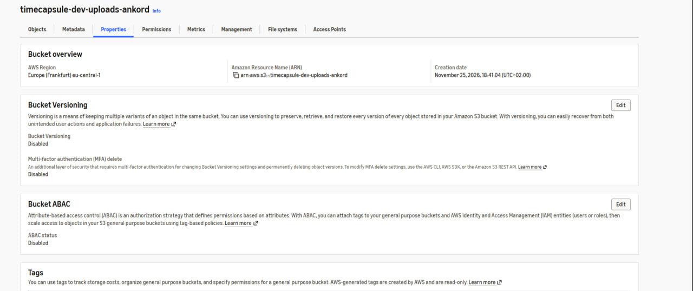

*Рисунок 3 — Свойства бакета: регион eu-central-1, ARN, Bucket Versioning = Disabled.*

Созданы папки `uploads/` и `backups/`, загружены картинка, PDF и текстовый файл.

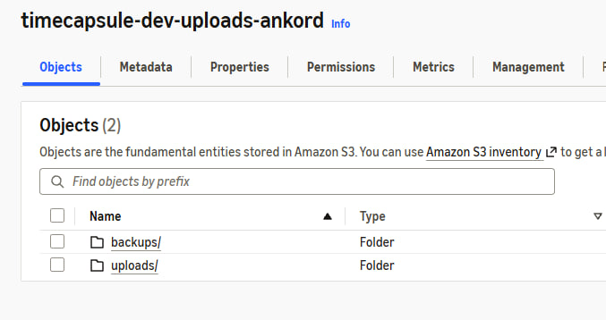

*Рисунок 4 — Папки `backups/` и `uploads/` в корне бакета.*

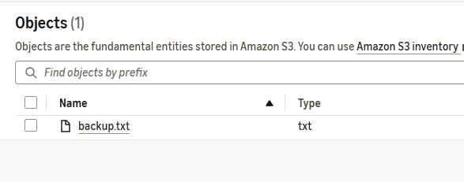

*Рисунок 5 — Содержимое `backups/`: `backup.txt`.*

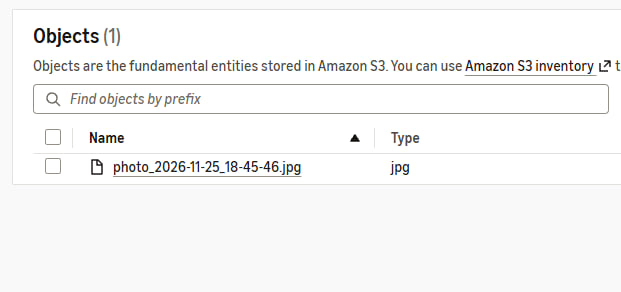

*Рисунок 6 — Содержимое `uploads/`: картинка `photo_2026-11-25_18-45-46.jpg`.*

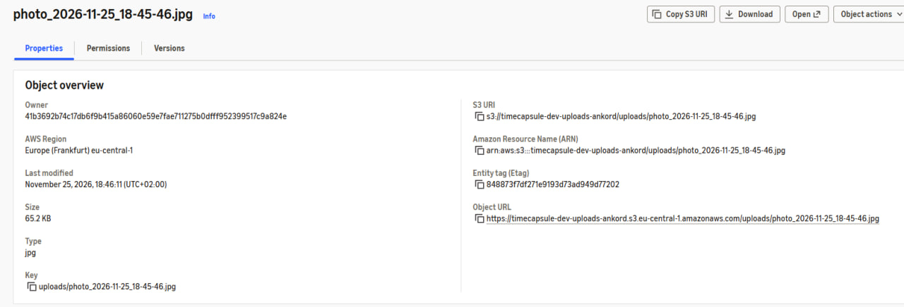

*Рисунок 7 — Свойства объекта-картинки.*

| Свойство | Значение |
|---|---|
| Ключ | `uploads/photo_2026-11-25_18-45-46.jpg` |
| Content-Type | `image/jpeg` (см. `head-object`, рис. 11) |
| ETag | `848873f7df271e9193d73ad949d77202` |
| Размер | 65,2 KB (66750 байт) |
| Object URL | `https://timecapsule-dev-uploads-ankord.s3.eu-central-1.amazonaws.com/uploads/photo_2026-11-25_18-45-46.jpg` |

Попытка открыть Object URL в браузере:

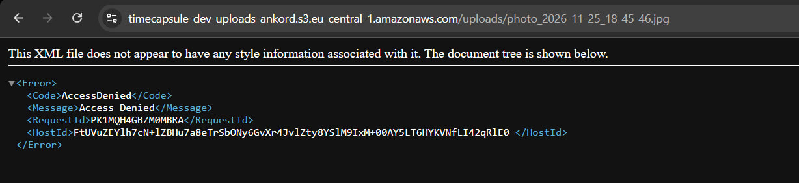

*Рисунок 8 — Object URL возвращает `AccessDenied`.*

**Вопросы**

- **Какой ключ у картинки?** `uploads/photo_2026-11-25_18-45-46.jpg`. В S3 нет настоящих папок: ключ — это полное имя объекта, а `uploads/` — просто его префикс.
- **Почему Object URL не открывается, хотя я владелец бакета?** Браузер отправляет анонимный запрос, без подписи. Права владельца действуют только для аутентифицированных запросов. Публичного доступа нет: включён Block Public Access, и нет политики или ACL, разрешающих чтение всем.
- **Что создала кнопка Create folder?** Пустой объект нулевого размера с ключом, оканчивающимся на `/` (`uploads/`, `backups/`). Консоль показывает его как папку. Эти объекты видны в `ls --recursive` (рис. 10).

## Задание 2. Объекты из командной строки

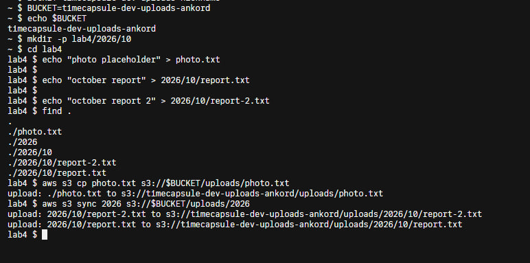

*Рисунок 9 — CloudShell: переменная `BUCKET`, создание файлов, `aws s3 cp` и `aws s3 sync`.*

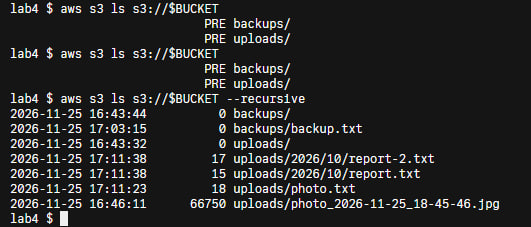

*Рисунок 10 — Вывод `aws s3 ls` (корень бакета) и `aws s3 ls --recursive`.*

<!-- ПРОВЕРИТЬ: на рис. 10 вторая команда набрана без /uploads/ и повторяет первую. Вывод `aws s3 ls s3://$BUCKET/uploads/` есть на рис. 14 (верхняя часть). Если хотите, переснимите вторую команду отдельно. -->

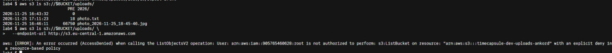

*Рисунок 14 — Вывод `aws s3 ls s3://$BUCKET/uploads/`: префикс `2026/`, файлы `photo.txt` и картинка.*

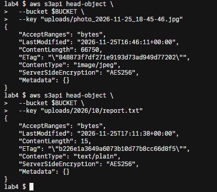

*Рисунок 11 — `aws s3api head-object` для картинки и для `uploads/2026/10/report.txt`.*

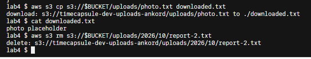

*Рисунок 12 — Скачивание `photo.txt` и удаление `report-2.txt`.*

**Вопросы**

- **Почему первая команда `ls` показывает `PRE uploads/` и `PRE backups/`, а третья — полные ключи?** Без `--recursive` CLI запрашивает список с разделителем `/` и показывает только «папки» первого уровня как общие префиксы (`PRE`). С `--recursive` разделитель не используется, и возвращаются все ключи, включая пустые объекты-папки.
- **Какой Content-Type получил `report.txt`?** `text/plain`. Я его не указывал: CLI определил тип по расширению файла `.txt` при загрузке.

## Задание 3. Политика бакета: только HTTPS

```json
{
  "Version": "2012-10-17",
  "Statement": [
    {
      "Sid": "DenyInsecureTransport",
      "Effect": "Deny",
      "Principal": "*",
      "Action": "s3:*",
      "Resource": [
        "arn:aws:s3:::timecapsule-dev-uploads-ankord",
        "arn:aws:s3:::timecapsule-dev-uploads-ankord/*"
      ],
      "Condition": {
        "Bool": { "aws:SecureTransport": "false" }
      }
    }
  ]
}
```

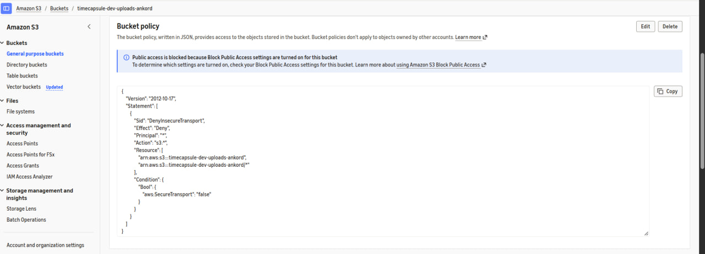

*Рисунок 13 — Политика бакета (Permissions → Bucket policy).*


*Рисунок 14 — Проверка: запрос по HTTPS проходит, запрос по `http://` получает `AccessDenied` (explicit deny in a resource-based policy).*

**Вопросы**

- **Почему вторая команда получает AccessDenied, хотя у меня полные права?** В политике бакета есть явный запрет (`Deny`) для запросов без HTTPS. Явный запрет сильнее любых разрешений, в том числе прав администратора.
- **Почему Block Public Access не помешал сохранить политику с `"Principal": "*"`?** Block Public Access блокирует политики, которые *открывают* доступ всем (`Allow` для `*`). Наша политика только запрещает, поэтому публичного доступа не создаёт.

## Задание 4. Версионирование и защита от удаления

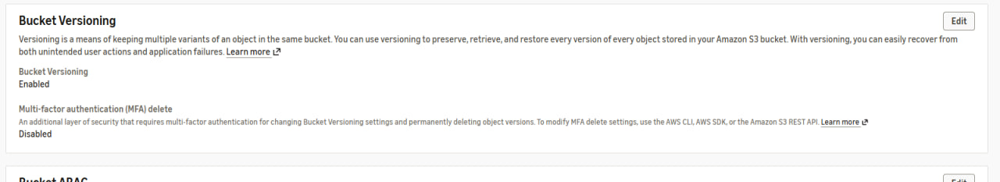

*Рисунок 15 — Bucket Versioning = Enabled.*

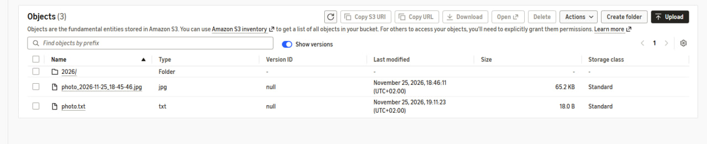

*Рисунок 16 — Show versions: у файлов, загруженных до включения версионирования, Version ID = `null`.*

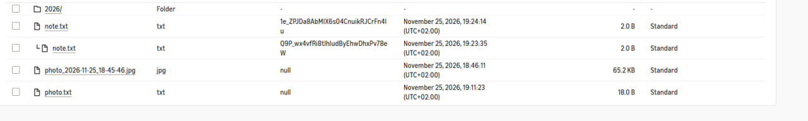

*Рисунок 17 — Две версии файла `note.txt` (19:23:35 и 19:24:14).*

<!-- ПРОВЕРИТЬ: в задании файл называется notes.txt, на скриншотах — note.txt. -->

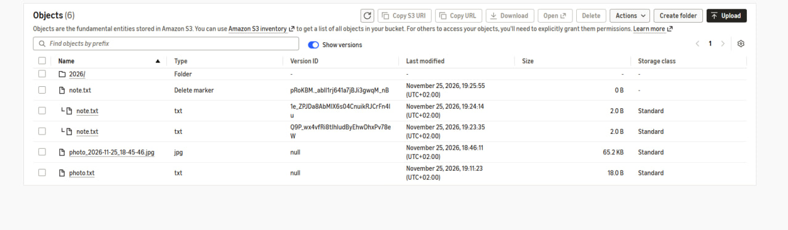

*Рисунок 18 — После удаления при выключенном Show versions: появился Delete marker (`pRoKBM…`, 0 B), обе версии остались на месте.*

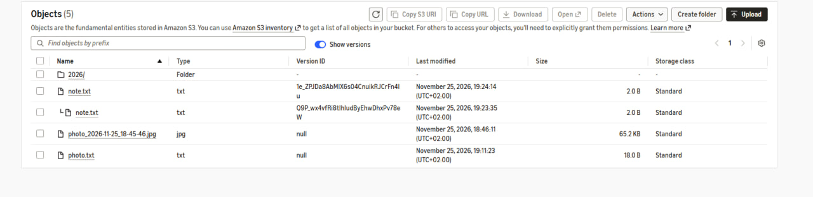

*Рисунок 19 — Маркер удаления удалён: `note.txt` снова виден с двумя версиями.*

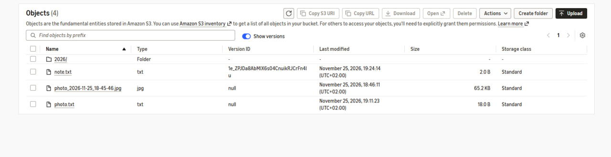

*Рисунок 20 — После удаления одной версии осталась одна версия `note.txt` (`1e_ZPJ…`, 19:24:14).*

<!-- ПРОВЕРИТЬ: по заданию нужно удалить версию v2, чтобы текущей стала v1. На рис. 20 осталась версия от 19:24:14, она же была текущей на рис. 17. Убедитесь, что в ней текст v1. Если там v2, значит удалена не та версия: пересоздайте историю и переснимите рис. 20. -->

**Вопросы**

- **Чем удаление в шаге 3 отличается от удаления в шаге 5?** В шаге 3 S3 только добавляет маркер удаления, а все версии остаются. В шаге 5 удаляется конкретная версия объекта, и это окончательно (консоль просит отдельное подтверждение).
- **Какое из них можно отменить?** Шаг 3: достаточно удалить маркер (шаг 4). Шаг 5 отменить нельзя.
- **Какой способ защищает от случайного удаления, а какой нужно запрещать приложению?** От случайного удаления защищает обычное удаление с маркером, так как данные сохраняются. Приложению нужно запретить удаление конкретной версии (`s3:DeleteObjectVersion`), иначе история версий перестаёт быть защитой.

## Задание 5. Правило жизненного цикла

Правило `timecapsule-dev-noncurrent`: область — префикс `uploads/`; неактуальные версии переходят в Standard-IA, затем удаляются с сохранением двух самых новых; незавершённые multipart-загрузки удаляются через 7 дней.

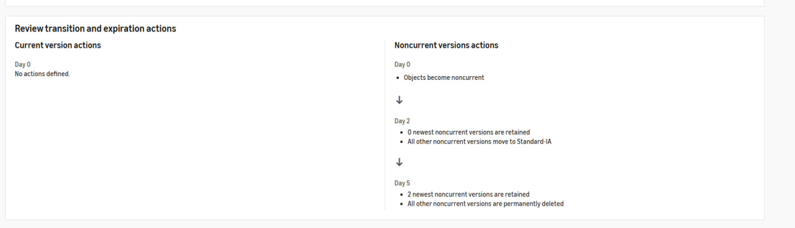

*Рисунок 21 — Схема правила (Review transition and expiration actions).*

<!-- ПРОВЕРИТЬ: на рис. 21 переходы стоят на Day 2 и Day 5, по заданию — 30 и 90 дней. Исправьте правило и переснимите рис. 21, если это не намеренно. Ответы ниже написаны для значений 30/90. -->

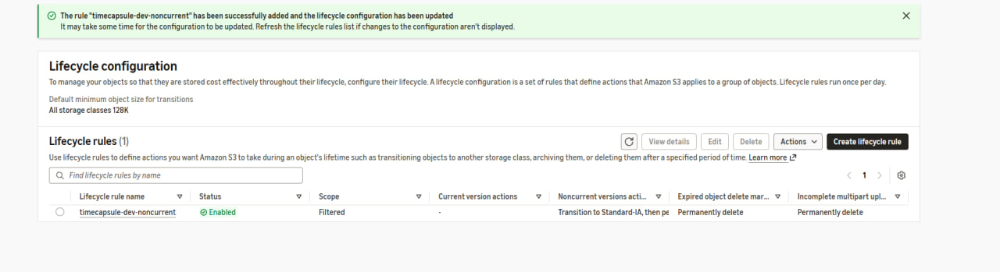

*Рисунок 22 — Правило создано и включено (Enabled, Scope: Filtered).*

**Вопросы**

- **Как поведёт себя правило для файла, который перезаписали 10 раз за неделю?** Будет 1 текущая и 9 неактуальных версий. Первые 30 дней после того, как версия стала неактуальной, ничего не происходит. Затем неактуальные версии переходят в Standard-IA. Через 90 дней удаляются все неактуальные версии, кроме двух самых новых: 7 версий будут удалены, 2 останутся.
- **Почему маленькие тестовые файлы в Standard-IA не попадут?** Минимальный размер объекта для переходов — 128 КБ (виден на рис. 22: *Default minimum object size for transitions: 128K*), а тестовые файлы занимают несколько байт.
- **Что такое незавершённая загрузка частями и почему за неё платят?** При multipart-загрузке файл отправляется частями. Если её не завершить и не отменить, загруженные части остаются в бакете, не видны в списке объектов и тарифицируются как хранение. Поэтому правило удаляет их через 7 дней.

## Задание 6. Подписанные URL

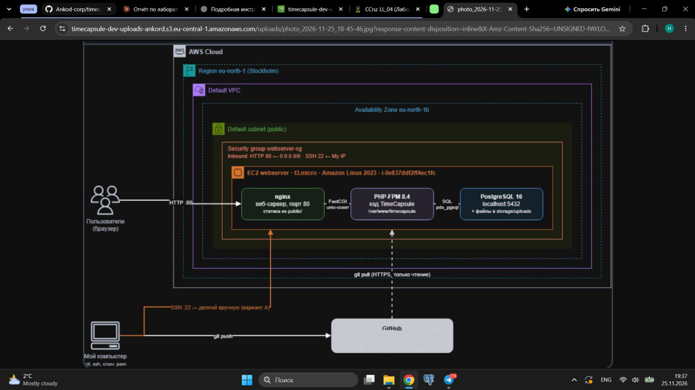

*Рисунок 23 — Подписанная ссылка из консоли, открытая в браузере: в адресе параметры `response-content-disposition` и `X-Amz-*`, картинка открывается.*

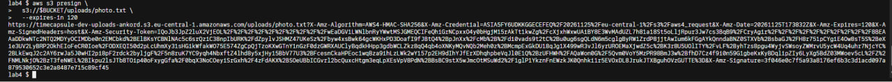

*Рисунок 24 — Ссылка из CLI: `aws s3 presign s3://$BUCKET/uploads/photo.txt --expires-in 120`.*

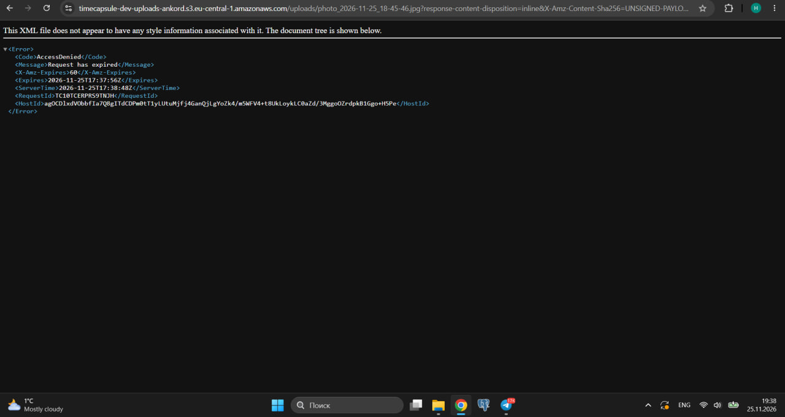

*Рисунок 25 — Ссылка из консоли после истечения срока: `AccessDenied`, `Request has expired`.*

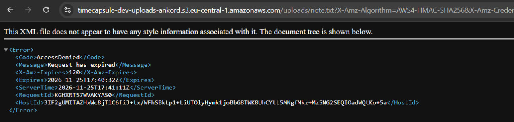

*Рисунок 26 — Ссылка с заменённым ключом (`note.txt`), открытая после истечения срока: `AccessDenied`, `Request has expired`, `X-Amz-Expires = 120`.*

<!-- ПРОВЕРИТЬ: в задании нужны два отдельных ответа S3: (3) на изменённую ссылку внутри срока (ожидается SignatureDoesNotMatch) и (4) на исходную просроченную ссылку photo.txt. На рис. 26 изменённая ссылка открыта уже после истечения срока. Для полноты можно добавить скриншот SignatureDoesNotMatch. -->

**Вопросы**

- **Какие ошибки вернул S3 в шагах 3 и 4?** После истечения срока — `AccessDenied` с сообщением `Request has expired` (рис. 25, 26). Для изменённой ссылки, открытой в пределах срока, S3 возвращает `SignatureDoesNotMatch`. S3 сначала проверяет срок, поэтому на рис. 26 просрочка отображается раньше несовпадения подписи.
- **Почему нельзя получить другой файл, просто поменяв ключ?** Подпись (`X-Amz-Signature`) вычисляется по параметрам запроса, в том числе по пути с ключом. После замены ключа подпись не совпадает с запросом.
- **Обращалась ли `aws s3 presign` к S3?** Нет. Ссылка подписывается локально ключами из текущих учётных данных, поэтому её можно создать даже для несуществующего объекта. Права и существование объекта проверяются только при открытии ссылки.

Временные файлы после Части 1 удалены (`cd ~ && rm -rf lab4`), бакет оставлен.

---

# Часть 2. Продвинутый уровень

## Задание 7. Политика приложения

Политика даёт права только на список объектов под `uploads/` и чтение, запись и удаление объектов под `uploads/`. `Action: "*"`, `s3:*` и `Resource: "*"` не используются.

```json
{
  "Version": "2012-10-17",
  "Statement": [
    {
      "Sid": "ListUploadsOnly",
      "Effect": "Allow",
      "Action": "s3:ListBucket",
      "Resource": "arn:aws:s3:::timecapsule-dev-uploads-ankord",
      "Condition": {
        "StringLike": { "s3:prefix": ["uploads/*"] }
      }
    },
    {
      "Sid": "ObjectsUnderUploads",
      "Effect": "Allow",
      "Action": ["s3:GetObject", "s3:PutObject", "s3:DeleteObject"],
      "Resource": "arn:aws:s3:::timecapsule-dev-uploads-ankord/uploads/*"
    }
  ]
}
```

<!-- ПРОВЕРИТЬ: JSON выше собран по требованиям задания. Сверьте его с вкладкой JSON вашей политики (рис. 28) и при необходимости поправьте. -->

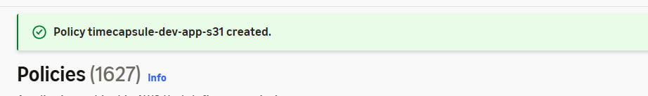

*Рисунок 27 — Политика создана.*

<!-- ПРОВЕРИТЬ: на рис. 27–28 имя политики `timecapsule-dev-app-s31`, на рис. 31 к роли подключена `timecapsule-dev-app-s3`. По заданию имя должно быть `timecapsule-dev-app-s3`. Проверьте, нет ли двух политик, и что использовалась правильная. -->

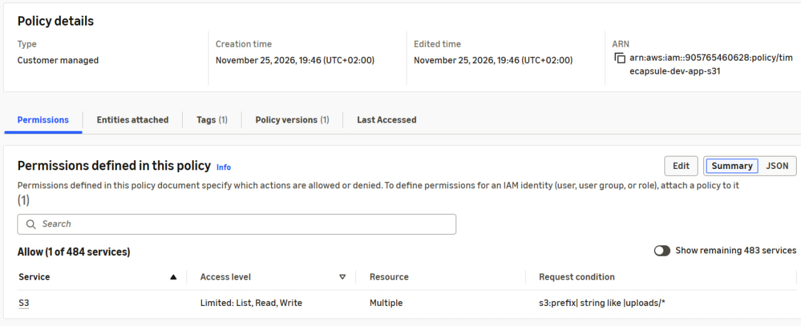

*Рисунок 28 — Сводка политики: сервис S3, доступ List/Read/Write, условие `s3:prefix` string like `uploads/*`.*

**Вопросы**

- **Почему `s3:ListBucket` относится к ресурсу «бакет», а `s3:GetObject` — к ресурсу «объект»?** Получение списка — операция над самим бакетом (ARN без `/*`), а чтение объекта — операция над конкретным объектом (ARN `.../*`).
- **Что будет, если перепутать ARN?** Правило перестанет срабатывать. `ListBucket` с ARN `.../uploads/*` не совпадёт с ресурсом запроса, а `GetObject` с ARN бакета не совпадёт ни с одним объектом. В обоих случаях запросы получат неявный запрет (`AccessDenied`).

## Задание 8. Проверка прав через тестовую роль

Создана роль `timecapsule-dev-s3-tester` (Trusted entity: This account, политика только `timecapsule-dev-app-s3`).

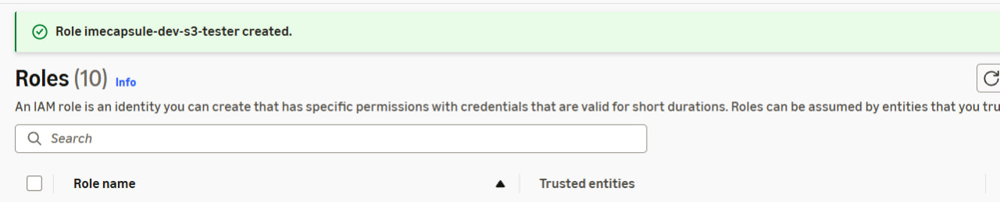

*Рисунок 29 — Тестовая роль создана.*

**[TODO]** Вставьте вывод `aws sts get-caller-identity` после `assume-role`: в поле `Arn` должно быть `...assumed-role/timecapsule-dev-s3-tester/lab4`.

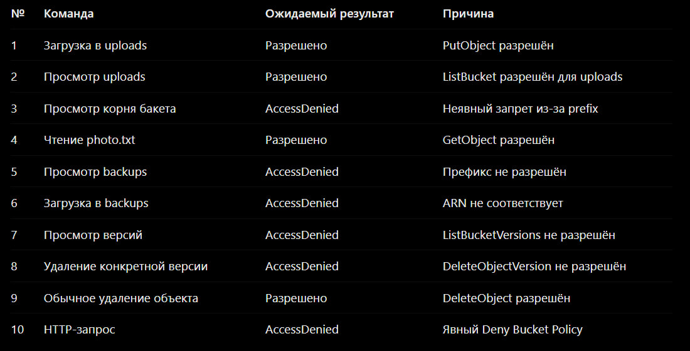

*Рисунок 30 — Таблица проверки прав: ожидаемый результат и причина для каждой команды.*

| № | Команда | Ожидаю | Получил | Какое правило сработало |
|---|---|---|---|---|
| 1 | `aws s3 cp test.txt s3://$BUCKET/uploads/test.txt` | Разрешено | Разрешено | Разрешение в политике приложения (`PutObject`) |
| 2 | `aws s3 ls s3://$BUCKET/uploads/` | Разрешено | Разрешено | Разрешение (`ListBucket` с префиксом `uploads/`) |
| 3 | `aws s3 ls s3://$BUCKET` | AccessDenied | AccessDenied | Неявный запрет (пустой префикс не подходит под условие) |
| 4 | `aws s3 cp s3://$BUCKET/uploads/photo.txt -` | Разрешено | Разрешено | Разрешение (`GetObject`) |
| 5 | `aws s3 ls s3://$BUCKET/backups/` | AccessDenied | AccessDenied | Неявный запрет (префикс не разрешён) |
| 6 | `aws s3 cp test.txt s3://$BUCKET/backups/test.txt` | AccessDenied |  AccessDenied | Неявный запрет (ARN не под `uploads/`) |
| 7 | `aws s3api list-object-versions --bucket $BUCKET --prefix uploads/` | AccessDenied | AccessDenied | Неявный запрет (`ListBucketVersions` не разрешён) |
| 8 | `aws s3api delete-object ... --version-id <VersionId>` | AccessDenied | AccessDenied | Неявный запрет (`DeleteObjectVersion` не разрешён) |
| 9 | `aws s3 rm s3://$BUCKET/uploads/test.txt` | Разрешено | Разрешено | Разрешение (`DeleteObject`) |
| 10 | `aws s3 ls ... --endpoint-url http://s3.eu-central-1.amazonaws.com` | AccessDenied | AccessDenied | Явный запрет в политике бакета (HTTP) |

**Вопросы**

- **Чем политика доверия роли отличается от политики прав?** Политика доверия определяет, *кто* может взять роль на себя (здесь — принципалы этого аккаунта). Политика прав определяет, *что* роль может делать после этого.
- **Что произошло с `test.txt` после команды 9, можно ли его восстановить?** Версионирование включено, поэтому `rm` не удалил данные, а добавил маркер удаления. Файл восстанавливается удалением маркера, но это делаю я как администратор: у роли приложения права на удаление версий нет.
- **Сможет ли злоумышленник с учётными данными приложения уничтожить файлы без возможности восстановления?** Нет. Он может перезаписывать объекты и ставить маркеры удаления только под `uploads/`, и все старые версии сохраняются. Удалить версию, отключить версионирование, сменить lifecycle или политику бакета он не может.
- **А если бы в политике было `s3:*`?** Тогда мог бы удалять версии окончательно, менять политику и правила жизненного цикла и приостанавливать версионирование, то есть уничтожить данные безвозвратно.

## Задание 9. Роль сервера

Роль `timecapsule-dev-app-role`: Trusted entity — AWS service (EC2), политика — только политика приложения.

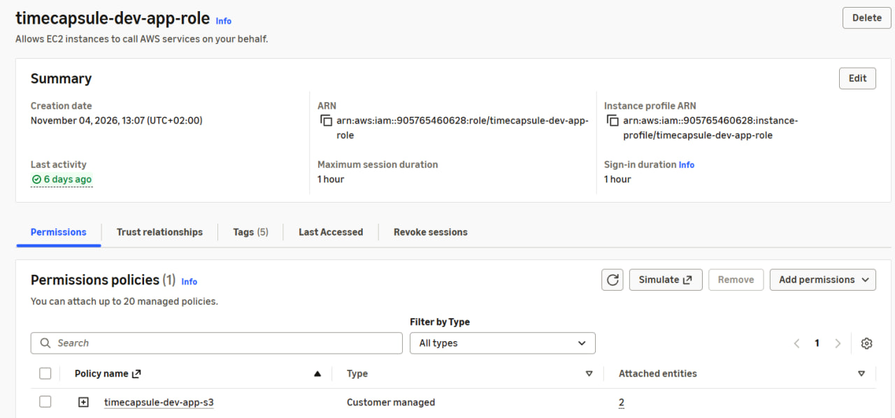

*Рисунок 31 — Роль `timecapsule-dev-app-role` с политикой `timecapsule-dev-app-s3`.*

<!-- ПРОВЕРИТЬ: на рис. 31 дата создания роли — 04.11.2026, то есть она создана раньше этой работы (возможно, в ЛР3). Если роль переиспользована, это нормально, но тогда проверьте политику доверия (EC2) и обязательные теги. -->

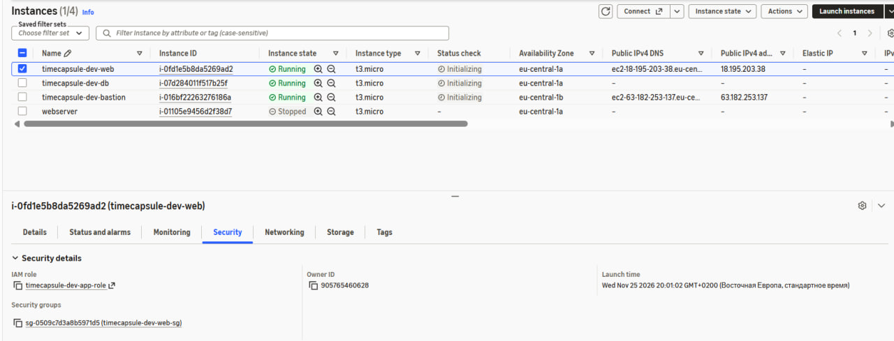

*Рисунок 32 — Инстанс `timecapsule-dev-web` (app-server) с привязанной ролью `timecapsule-dev-app-role` (Security → IAM role).*

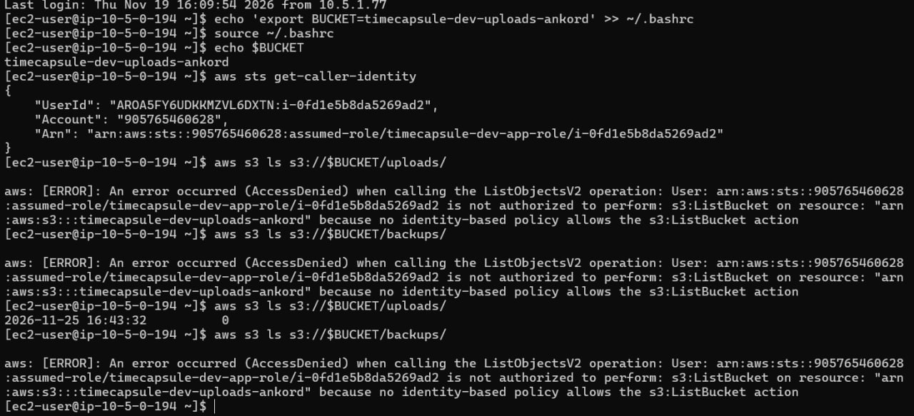

*Рисунок 33 — На app-server: `aws sts get-caller-identity` показывает `assumed-role/timecapsule-dev-app-role/i-0fd1e5b8da5269ad2`. Первые попытки `ls` получили AccessDenied (в политике не было разрешения на `ListBucket`). После обновления политики `ls uploads/` проходит, а `ls backups/` по-прежнему получает AccessDenied.*

**Вопросы**

- **Где AWS CLI взял учётные данные?** Из сервиса метаданных инстанса (IMDS): к EC2 привязан instance profile с ролью, и CLI автоматически получает от него временные учётные данные.
- **Чем политика доверия этой роли отличается от тестовой?** В тестовой роли доверие выдано аккаунту (`Principal: AWS`, роль берёт пользователь через `assume-role`). В роли сервера — сервису EC2 (`Principal: Service ec2.amazonaws.com`), и роль получает сам инстанс.
- **Почему это безопаснее ключа в `.env`?** Нет долгоживущего секрета, который можно потерять, закоммитить в репозиторий или украсть с диска. Учётные данные временные и автоматически обновляются, а права ограничены политикой роли.

## Задание 10. Перенос существующих файлов

```bash
cd /var/www/timecapsule/current
aws s3 sync storage/uploads s3://$BUCKET/uploads/ --dryrun
aws s3 sync storage/uploads s3://$BUCKET/uploads/
```

**[TODO]** Вставьте скриншот вывода `aws s3 sync`, повторного `--dryrun` (пустой вывод) и `Content-Type` одного из перенесённых объектов.

**Вопрос: хватило ли прав политики приложения для `aws s3 sync`, какие действия использовала команда?** Хватило. `sync` использует `s3:ListBucket` (сравнивает локальные файлы с содержимым `uploads/`; запрос идёт с префиксом `uploads/`, поэтому условие выполняется) и `s3:PutObject` (загрузка недостающих файлов).

## Задание 11. Модуль хранения на S3

**Ссылка на изменения:** [TODO: ссылка на коммит или pull request с новым модулем хранения]

Реализованные изменения (по требованиям задания):

- SDK подключён через `composer require aws/aws-sdk-php` (`composer.json`, `composer.lock` закоммичены).
- В `.env.example` и на сервере добавлены `S3_BUCKET=timecapsule-dev-uploads-ankord` и `AWS_REGION=eu-central-1`. Ключей доступа в `.env` нет: SDK берёт учётные данные роли сервера.
- `storage_save()` загружает файл под ключом `uploads/<случайное имя>` с правильным `ContentType` и возвращает имя. `storage_delete()` удаляет объект. `storage_stream()` перенаправляет браузер (302) на подписанный URL сроком 5 минут с типом содержимого и именем файла.
- В подвале страницы вместо `local disk` указано имя бакета.

<!-- ПРОВЕРИТЬ: подтвердите, что описание соответствует вашему коду. Косвенные подтверждения: на рис. 34 объект имеет случайное имя, на рис. 36 файл скачивается под исходным именем, на рис. 23 в ссылке есть response-content-disposition. -->

## Задание 12. Деплой и проверка

**Новые капсулы.** Создана капсула `test` с картинкой, время открытия — через 2 минуты.

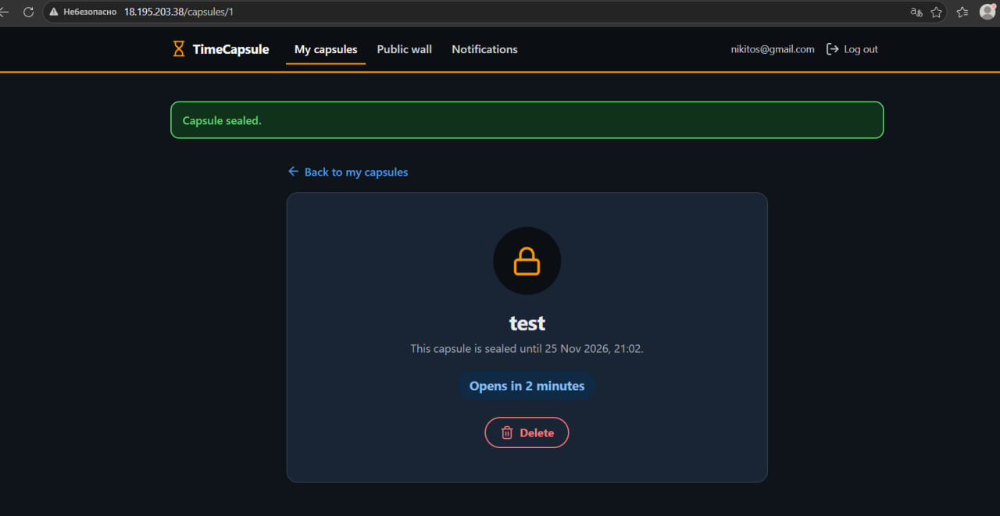

*Рисунок 35 — Капсула запечатана: «Opens in 2 minutes».*

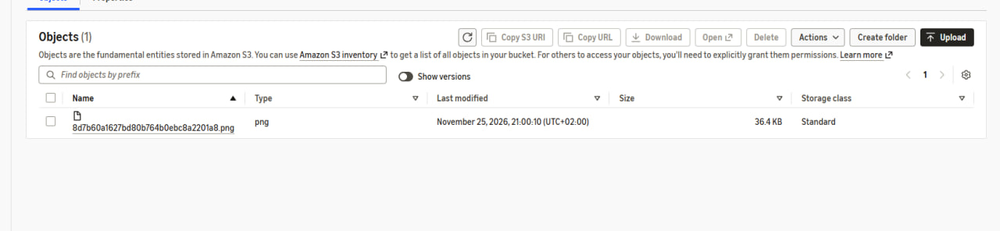

*Рисунок 34 — Новый объект под `uploads/` в бакете: `8d7b60a1627bd80b764b0ebc8a2201a8.png`, 36,4 KB, Standard, 21:00:10.*

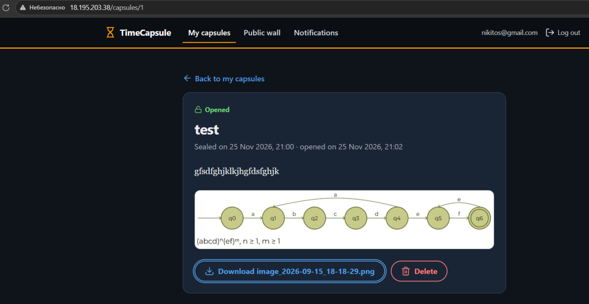

*Рисунок 36 — Капсула открылась: картинка отображается, кнопка скачивания предлагает исходное имя `image_2026-09-15_18-18-29.png`.*

**Удаление.** Капсула с вложением удалена.

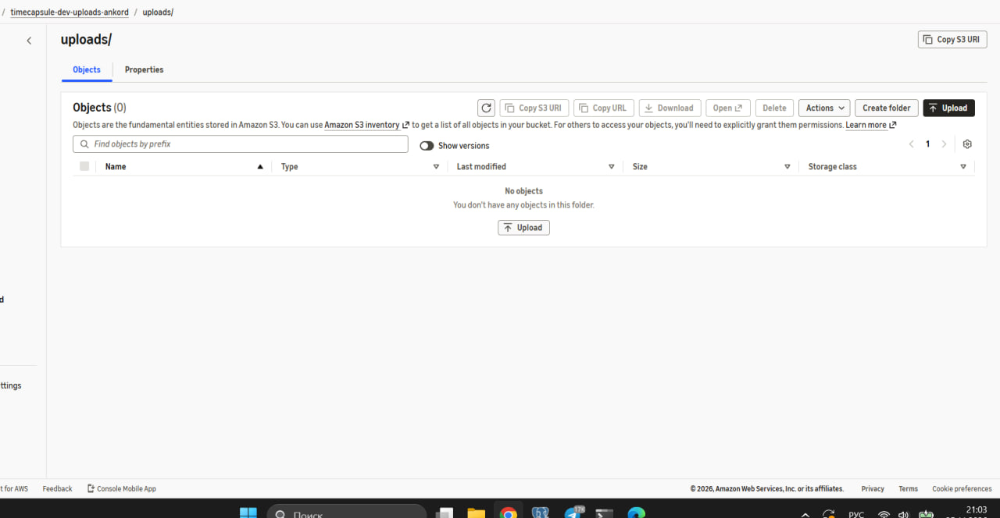

*Рисунок 37 — После удаления `uploads/` выглядит пустым (Show versions выключен).*

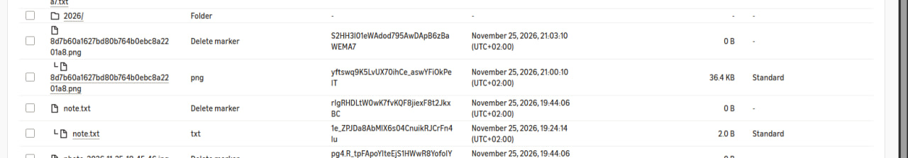

*Рисунок 38 — Show versions: над версией объекта (21:00:10) появился Delete marker (21:03:10). Данные остались как неактуальная версия.*

**[TODO]** Добавьте скриншоты:

1. капсула с PDF (сохранился под исходным именем) и Content-Type новых объектов;
2. адресная строка с подписанным URL `...s3.eu-central-1.amazonaws.com/uploads/...?X-Amz-...`;
3. старая капсула из ЛР2, вложение которой отдаёт S3;
4. ответ S3 на ссылку через 5 минут.

**Вопросы**

- **Почему ссылку, которую пользователь переслал другу, не нужно специально отзывать?** Ссылка действует 5 минут и после этого перестаёт работать сама: S3 отвечает `Request has expired` (как на рис. 25). Любой, у кого есть ссылка, может открыть файл только в этот короткий промежуток.
- **Что осталось в бакете после удаления капсулы и когда это исчезнет?** Остались неактуальная версия объекта и маркер удаления (рис. 38). По правилу `timecapsule-dev-noncurrent` в `uploads/` сохраняются две самые новые неактуальные версии, а у этого объекта она одна, поэтому автоматически она не удалится. Окончательно убрать её можно вручную (удалением версии) или изменив правило так, чтобы не сохранять неактуальные версии.

## Задание 13. Сервер без состояния

**[TODO]** Вставьте скриншоты: приложение с вложениями после `mv storage/uploads ~/uploads-backup`; `aws s3 ls s3://$BUCKET/uploads/` на сервере с `AccessDenied` после новой версии политики без `s3:ListBucket`; ответы на запрос `aws s3 cp s3://$BUCKET/uploads/no-such-file.txt -` на сервере и в CloudShell.

**Вопросы**

- **Почему S3 ответил по-разному, хотя объекта нет в обоих случаях?** Мне (с правом `s3:ListBucket`) S3 вернёт `404 NoSuchKey`. Серверу, у которого этого права нет, вернётся `403 AccessDenied`: без права на список S3 не раскрывает, есть ли такой объект.
- **Зачем S3 так поступает?** Чтобы нельзя было перебором выяснить, какие ключи существуют в бакете. Если бы S3 отвечал 404 на несуществующие объекты и 403 на существующие, но недоступные, по ответу можно было бы узнать, что объект есть.
- **Что теперь нужно сделать, чтобы заменить app-server новым сервером без потери данных?** Запустить новый инстанс с той же ролью (`timecapsule-dev-app-role`), развернуть код, создать `.env` с `S3_BUCKET` и `AWS_REGION` и подключить его к db-server. Вложения лежат в S3, поэтому терять нечего.

## Задание 14. Архитектура и решение

---

# Итог

Бакет `timecapsule-dev-uploads-ankord` закрыт для публичного доступа и защищён политикой «только HTTPS», версионированием и правилом жизненного цикла. Приложение работает через роль сервера с минимальной политикой и отдаёт вложения подписанными ссылками на 5 минут.
