# Лабораторная работа №5. Облачные базы данных. Amazon RDS

|  |  |
|---|---|
| **Группа** | IA2404 |
| **Уровень** | Продвинутый (задания 1–12) |

Регион: `eu-central-1` (Frankfurt), VPC из ЛР3 (`10.5.0.0/16`). Номера рисунков совпадают с номерами файлов в `img/`. Места, где не хватает скриншота или вывода команды, помечены **[TODO]**.

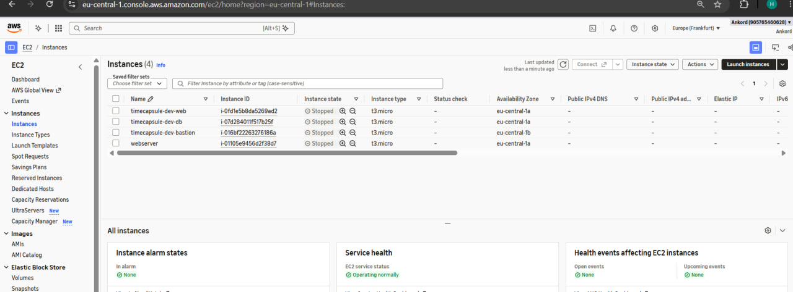

*Рисунок 1 — Исходное состояние перед работой: серверы ЛР3 (`timecapsule-dev-web`, `timecapsule-dev-db`, `timecapsule-dev-bastion`, `webserver`) остановлены, регион Europe (Frankfurt).*

---

# Часть 1. Базовый уровень

## Задание 1. Размещение и доступ к базе

Создана группа подсетей `lab5-db-subnets` из двух приватных подсетей VPC ЛР3 в разных зонах доступности.

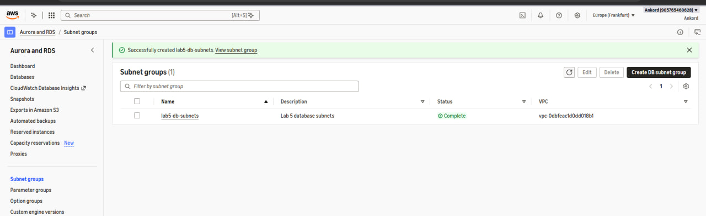

*Рисунок 2 — Группа подсетей `lab5-db-subnets` создана (статус Complete).*

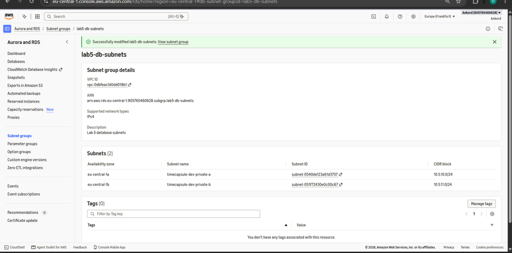

*Рисунок 4 — Состав группы: `timecapsule-dev-private-a` (`10.5.10.0/24`, eu-central-1a) и `timecapsule-dev-private-b` (`10.5.11.0/24`, eu-central-1b).*

Доступ к базе ограничен группой безопасности, которая принимает PostgreSQL (TCP 5432) только от группы безопасности веб-сервера.

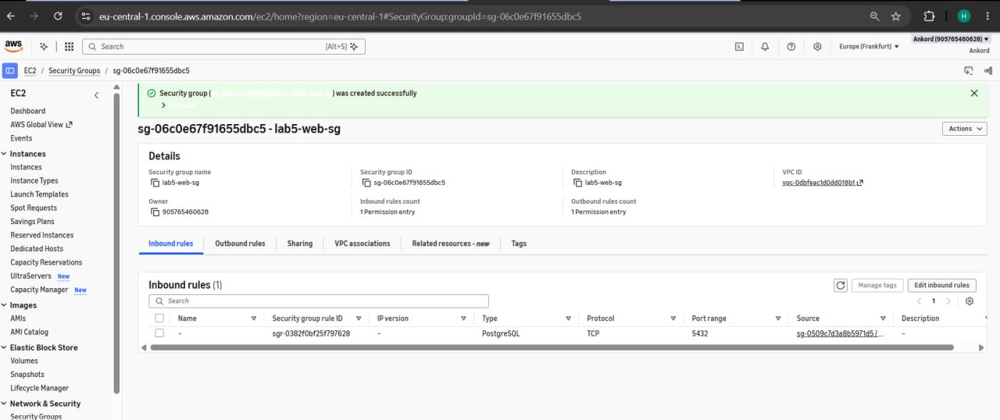

*Рисунок 3 — Security Group `lab5-web-sg`: входящее правило PostgreSQL, TCP 5432, источник — группа безопасности (`sg-0509c7d3a8b5971d5`, веб-сервер), а не IP-адрес.*

**Вопросы**

- **Почему для ограничения доступа удобнее использовать Security Group источника, а не его IP-адрес?** Группа безопасности описывает *роль* источника, а не конкретный адрес. После перезапуска или замены сервера его частный IP меняется, но он остаётся в той же группе, и правило продолжает работать. Новые серверы приложения получают доступ автоматически, а правило не нужно переписывать.
- **Зачем указывать две подсети, если учебная база будет работать в одной зоне?** Группа подсетей RDS должна покрывать минимум две зоны доступности. Это нужно, чтобы RDS мог разместить резервный экземпляр (Multi-AZ), реплику или восстановленную копию в другой зоне и мог переместить экземпляр при необходимости.

## Задание 2. База RDS

Параметры учебной базы `lab5-db` (по заданию): PostgreSQL последней версии, шаблон Sandbox, `db.t4g.micro`, gp3 20 ГиБ без автомасштабирования, пользователь `dbadmin`, группа подсетей `lab5-db-subnets`, зона eu-central-1a, без публичного доступа, группа безопасности `lab5-rds-sg`, база `lab5`, хранение резервных копий 7 дней, шифрование и deletion protection включены.

**[TODO]** Скриншот базы `lab5-db` в состоянии Available (вкладки Connectivity & security и Configuration).

**Вопросы**

- **Как убедиться, что база принимает подключения только с нужного сервера?** Подключиться с веб-сервера (`psql -h <endpoint> -U dbadmin -d lab5`) и убедиться, что соединение устанавливается. Затем попробовать с другого места, например с моего компьютера или с экземпляра без нужной группы безопасности: соединение должно завершиться таймаутом. Дополнительно у базы Publicly accessible = No, и у неё нет публичного IP.
- **Почему выбрана зона eu-central-1a?** В этой зоне работает веб-сервер. Трафик внутри одной зоны быстрее и не тарифицируется как межзонный. Вторая зона (eu-central-1b) используется для реплики.
- **От чего защищает deletion protection, а от чего нет?** Защищает от случайного удаления самого экземпляра через консоль или API. Не защищает от потери данных внутри базы (`DELETE`, `DROP TABLE`), от повреждения данных, от сбоя экземпляра и не мешает изменить настройку защиты командой `Modify`.

## Задание 3. Подключение к базе
Команды для проверки:

```bash
psql -h <endpoint> -U dbadmin -d lab5
```

```sql
SELECT version();
\conninfo
CREATE TABLE notes (
   id         SERIAL PRIMARY KEY,
   body       VARCHAR(100) NOT NULL,
   created_at TIMESTAMPTZ NOT NULL DEFAULT now()
);
INSERT INTO notes (body) VALUES ('first'), ('second'), ('third');
SELECT * FROM notes;
```

## Задание 4. Реплика для чтения

**Вопросы**

- **Почему `INSERT` на реплике не выполнился?** Реплика работает в режиме восстановления (`pg_is_in_recovery() = true`) и только применяет изменения основной базы. Она доступна лишь для чтения, и запись отклоняется ошибкой read-only.
- **Чем реплика для чтения отличается от Multi-AZ?** Реплика асинхронная, у неё свой endpoint. Она принимает запросы на чтение и разгружает основную базу, но не переключается автоматически. Резервный экземпляр Multi-AZ получает изменения синхронно, не принимает запросов и нужен для автоматического переключения при отказе. Endpoint при этом остаётся прежним.

## Задание 5. Восстановление после ошибки

**Вопросы**

- **Почему реплика не спасла данные?** Репликация передаёт на реплику все изменения основной базы, в том числе ошибочные. После `DELETE` строки исчезают и на реплике. Реплика нужна для чтения и нагрузки, а не как резервная копия.
- **Почему восстановление создаёт новую базу, а не откатывает старую?** RDS собирает базу из снимка и журналов изменений за выбранный момент как отдельный экземпляр с новым endpoint. Старая база остаётся нетронутой: её можно сравнить с копией, выбрать из неё нужные данные и безопасно удалить после проверки.

## Завершение Части 1

---

# Часть 2. Продвинутый уровень

## Задание 6. База приложения

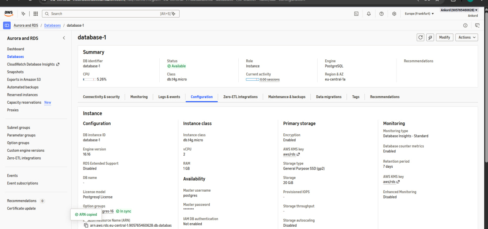

*Рисунок 5 — Экземпляр RDS, вкладка Configuration: PostgreSQL 16.16, `db.t4g.micro` (2 vCPU, 1 GB RAM), 20 GiB, шифрование включено, автомасштабирование хранилища выключено, статус Available, зона eu-central-1a.*

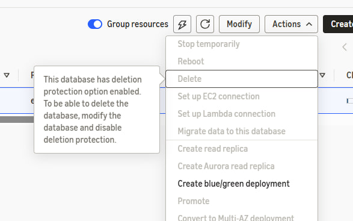

*Рисунок 13 — У базы включена deletion protection: пункт Delete недоступен, подсказка предлагает сначала отключить защиту через Modify.*

<!-- ПРОВЕРИТЬ: по заданию база называется `timecapsule-dev-rds`, мастер-пользователь `dbadmin`, хранилище gp3, должны быть теги и вкладка Connectivity & security. На скриншоте: идентификатор `database-1`, мастер-пользователь `postgres`, тип хранилища gp2. Если это база приложения, переименуйте её (Modify → DB instance identifier) или пересоздайте; учтите, что при переименовании меняется endpoint, а в политике расписания указан ARN по имени. Добавьте скриншот Connectivity & security: Publicly accessible = No, группа безопасности, группа подсетей. -->

**Вопрос: какие параметры вы выбрали бы иначе для рабочей системы с реальными пользователями?**

- Multi-AZ: чтобы база пережила отказ зоны без ручного вмешательства.
- Не `db.t4g.micro` с ограниченными кредитами, а более мощный класс.
- gp3 с автомасштабированием, чтобы диск не закончился неожиданно.
- Хранение резервных копий дольше 7 дней и финальный снимок при удалении.
- Шаблон Production, мониторинг и оповещения, пароль в Secrets Manager.

## Задание 7. Ночная остановка базы

Политика `timecapsule-dev-rds-stop` разрешает только `rds:StopDBInstance` для базы приложения. Роль `timecapsule-dev-scheduler-role` доверяет только `scheduler.amazonaws.com`.

```json
{
  "Version": "2012-10-17",
  "Statement": [
    {
      "Effect": "Allow",
      "Action": "rds:StopDBInstance",
      "Resource": "arn:aws:rds:eu-central-1:905765460628:db:timecapsule-dev-rds"
    }
  ]
}
```

<!-- ПРОВЕРИТЬ: JSON собран по требованиям задания. Сверьте с вкладкой JSON вашей политики, особенно ARN базы (на рис. 5 база называется database-1). -->

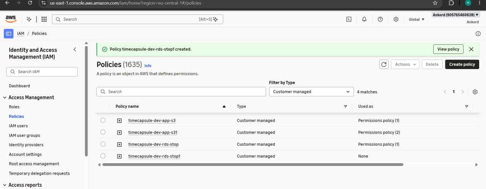

*Рисунок 6 — Политика создана. В списке customer managed политик рядом лежат похожие по имени `timecapsule-dev-rds-stop` и `timecapsule-dev-rds-stop1`.*

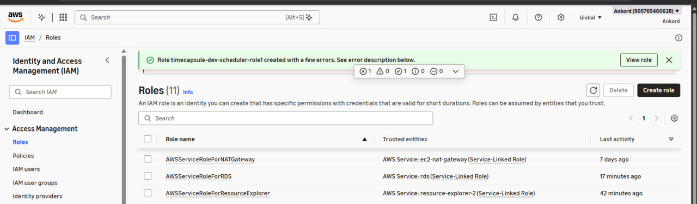

*Рисунок 7 — Роль для расписания создана (сообщение консоли: «created with a few errors»).*

<!-- ПРОВЕРИТЬ: на рис. 6–7 политика и роль названы `...-rds-stop1` и `...-scheduler-role1`, а в списке есть и `timecapsule-dev-rds-stop` (используется 1 раз). Роль создана «with a few errors» (обычно это не добавились теги). Убедитесь, что расписание использует нужную роль, к роли подключена нужная политика, а лишние дубликаты удалены. -->

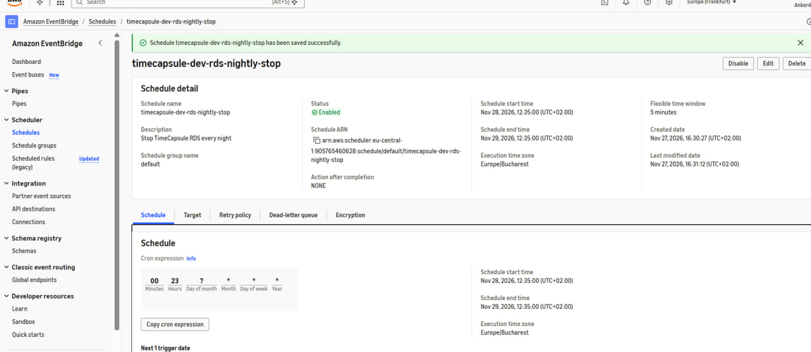

*Рисунок 8 — Расписание `timecapsule-dev-rds-nightly-stop` сохранено (Enabled): cron `0 23 * * ? *`, часовой пояс Europe/Bucharest, действие после завершения — NONE.*

**Вопросы**

- **Зачем расписанию своя роль, если я могу остановить базу сам?** Расписание выполняется сервисом EventBridge Scheduler, а не от моего имени. У него нет моих прав, поэтому он берёт на себя роль, которой разрешено ровно это действие. Так я не раздаю сервису свои полные права.
- **Почему роль может остановить только одну базу?** В политике указано одно действие (`rds:StopDBInstance`) и один ресурс (ARN базы приложения). Если роль будет скомпрометирована или расписание ошибётся, остановить другие базы она не сможет.

## Задание 8. Пользователь и база данных


```sql
CREATE USER timecapsule;
\password timecapsule
GRANT timecapsule TO dbadmin;
CREATE DATABASE timecapsule OWNER timecapsule;
```

**Вопрос: почему приложению нужен отдельный пользователь, а не `dbadmin`?** Принцип наименьших привилегий. `dbadmin` может создавать базы и роли и управлять всем экземпляром. Если приложение будет взломано (например, через SQL-инъекцию), злоумышленник с отдельным пользователем получит доступ только к базе `timecapsule`. Отдельного пользователя можно также отключить или сменить ему пароль, не затрагивая администратора.

## Задание 9. Перенос данных

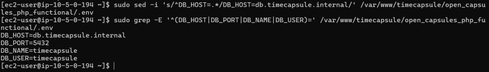

## Задание 10. Переключение приложения

После переключения приложение продолжает использовать то же имя `db.timecapsule.internal`: в зоне Route 53 запись A на db-server заменена на CNAME на endpoint базы.


*Рисунок 9 — `.env` приложения: `DB_HOST=db.timecapsule.internal`, `DB_PORT=5432`, `DB_NAME=timecapsule`, `DB_USER=timecapsule`. Значение `DB_HOST` не менялось.*

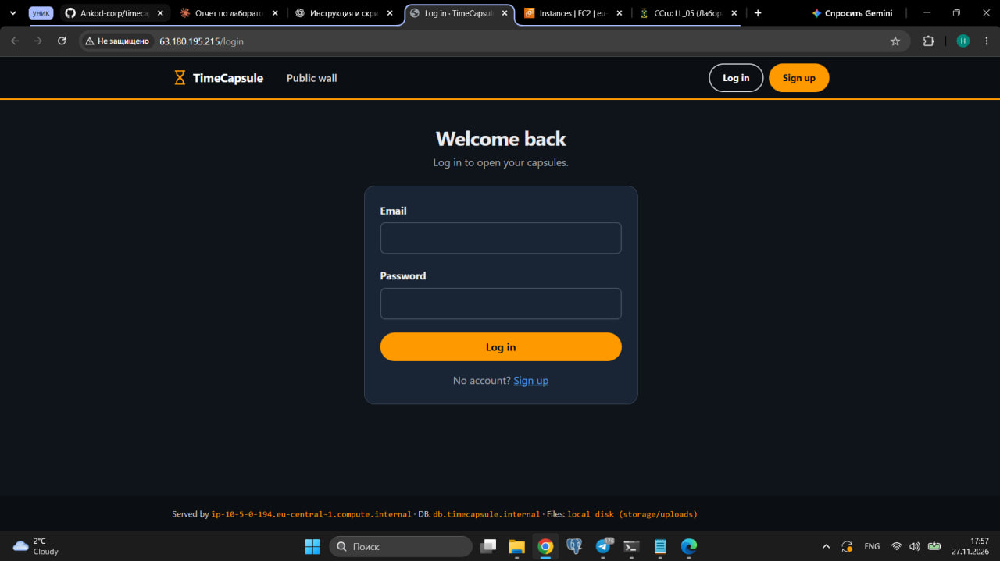

*Рисунок 10 — Приложение открывается; в подвале страницы указано `DB: db.timecapsule.internal`.*

**[TODO]** Скриншоты: `dig db.timecapsule.internal` (ответ CNAME с endpoint RDS), `/health`, новая капсула в таблице `capsules` в RDS, список инстансов EC2 без `db-server`.

**Вопросы**

- **Почему не пришлось менять `DB_HOST`?** Приложение обращается к базе по DNS-имени, и менялась только запись в зоне: вместо A-записи на db-server теперь CNAME на endpoint RDS. Приложение при этом не знает о переезде.
- **Какие обязанности из ЛР3 перешли к AWS, а какие остались за мной?** К AWS перешли установка обновлений СУБД и ОС, управление железом, автоматические резервные копии и восстановление на любой момент за 7 дней. За мной остались схема и данные, пользователи и пароли, правила доступа (Security Groups), настройка размера и стоимости (в том числе остановка базы), мониторинг и выбор момента для крупных обновлений.

## Задание 11. Обслуживание базы

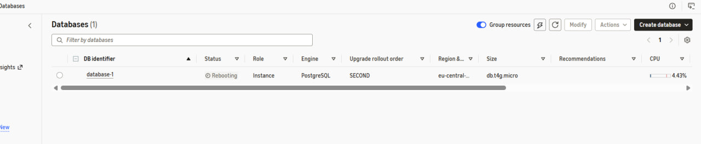

*Рисунок 12 — Перезагрузка базы: статус Rebooting.*

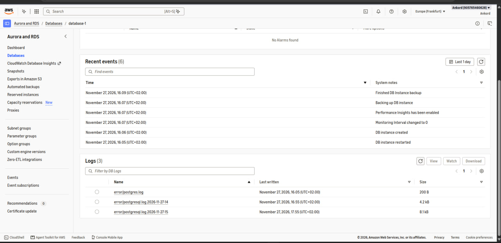

*Рисунок 11 — Logs & events: события экземпляра (DB instance created, DB instance restarted, Backing up DB instance, Finished DB Instance backup, Performance Insights has been enabled) и журналы PostgreSQL.*

**Вопросы**

- **Что показывал `/health` во время перезагрузки?** **[TODO: вставить, что вы увидели.]** Пока база недоступна, приложение не может подключиться, и проверка сообщает об ошибке (недоступна БД). После перезагрузки проверка снова проходит.
- **Изменился ли endpoint после остановки и запуска?** Нет. Endpoint — это постоянное DNS-имя экземпляра. Может меняться только IP-адрес за ним, поэтому приложение подключается по имени.
- **Какую ошибку получает расписание, если база уже остановлена?** `StopDBInstance` для базы не в состоянии `available` завершается ошибкой `InvalidDBInstanceState`. Расписание не остановит уже остановленную базу и покажет ошибку вызова.

## Задание 12. Архитектура и решение

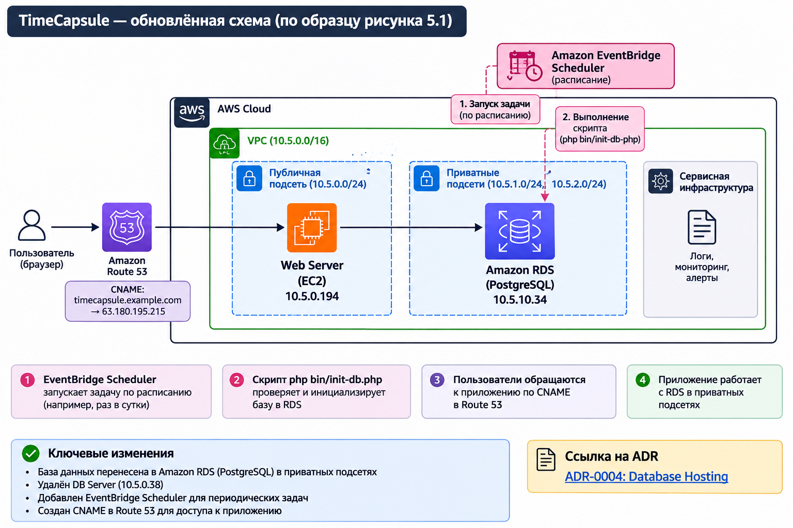
---

# Итог

Группа подсетей, правила доступа и база RDS созданы в приватных подсетях. Остановка базы по ночам настроена через EventBridge Scheduler. Приложение работает с RDS через прежнее имя `db.timecapsule.internal`.
